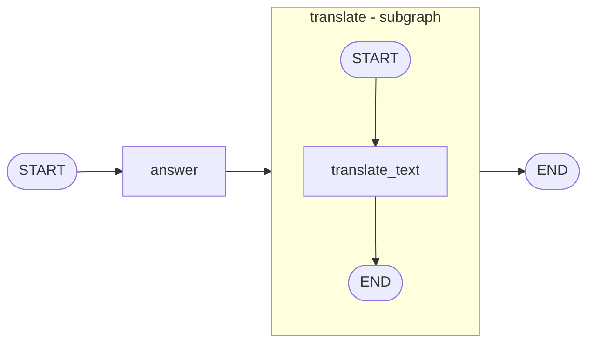

# LangGraph Subgraphs

Learn how to build **subgraphs** in LangGraph: small graphs that run as a single node inside a bigger graph.

This project shows the two ways to connect a subgraph to a parent graph, using one example: the parent graph answers a question in English, and a subgraph translates that answer into Hindi with a local model.

---

## What is a subgraph?

A subgraph is a graph that is embedded and executed as a node inside another graph.

Subgraphs help you build complex workflows in a clean way:

- **Modularity**: split a large workflow into small, understandable pieces
- **Reusability**: build a subgraph once and use it in many graphs
- **Maintainability**: change one part without touching the rest
- **Failure isolation**: problems stay inside one subgraph
- **State separation**: a subgraph can keep its own private state
- **Observability**: it is easier to see which part did what

## The two types of subgraph

| | Type 1: invoke from a node | Type 2: add as a node |
|---|---|---|
| Notebook | `15_subgraph.ipynb` | `16_subgraph_shared.ipynb` |
| State | Parent and subgraph have **different** state | Parent and subgraph **share** state keys |
| How it is connected | Call `subgraph.invoke(...)` inside a parent node | `parent_builder.add_node("translate", subgraph)` |
| Data conversion | You map the input and output yourself | Shared keys flow automatically |
| Best when | Schemas differ or the subgraph must stay private | Schemas overlap and you want less code |

## How the example works



1. The **parent graph** takes a `question` and the `answer` node writes an English answer to `answer_eng`.
2. The `translate` step is a **subgraph**. It translates `answer_eng` into Hindi.
3. The Hindi text is stored in `answer_hin`.

### Type 1: different state (`15_subgraph.ipynb`)

The subgraph has its own state (`input_text`, `translated_text`). A parent node converts the state in and out:

```python
def translate_answer(state: ParentGraph):
    result = subgraph.invoke({"input_text": state["answer_eng"]})   # parent -> subgraph
    return {"answer_hin": result["translated_text"]}                # subgraph -> parent

parent_builder.add_node("translate", translate_answer)
```

### Type 2: shared state (`16_subgraph_shared.ipynb`)

Parent and subgraph use the same state class, so the compiled subgraph is added directly as a node:

```python
subgraph = subgraph_builder.compile()                 # StateGraph(ParentState)
parent_builder.add_node("translate", subgraph)        # no conversion code needed
```

## Project structure

```
langgraph-subgraphs/
├── 15_subgraph.ipynb            # Type 1: invoke a subgraph from a node (different state)
├── 16_subgraph_shared.ipynb     # Type 2: add a subgraph as a node (shared state)
├── docs/
│   └── LangGraph_Subgraphs_Guide.pdf   # detailed learning guide (optional)
└── README.md
```

## Prerequisites

- Python 3.10 or newer is recommended (the notebooks were run on Python 3.9.6)
- [Ollama](https://ollama.com) installed and running
- Jupyter Notebook, JupyterLab, or VS Code with the Jupyter extension

## Setup

1. **Clone the repository**

   ```bash
   git clone <your-repo-url>
   cd langgraph-subgraphs
   ```

2. **Create a virtual environment (recommended)**

   ```bash
   python -m venv venv
   source venv/bin/activate        # Windows: venv\Scripts\activate
   ```

3. **Install the dependencies**

   ```bash
   pip install -U langgraph langchain-ollama ipykernel
   ```

4. **Download the model**

   ```bash
   ollama pull qwen2.5
   ```

5. **Make sure Ollama is running**, then open a notebook and run the cells from top to bottom.

## Example usage

```python
graph.invoke({"question": "What is quantum physics"})
```

The result contains three keys:

```python
{
  "question":   "What is quantum physics",
  "answer_eng": "Quantum physics, also known as quantum mechanics, is a fundamental theory ...",
  "answer_hin": "<the Hindi translation of the English answer>"
}
```

## Key concepts

- **Parent graph**: the outer graph that uses the subgraph as a node
- **Subgraph**: a compiled graph that runs inside a node of the parent
- **Interface**: the input and output state keys the subgraph exposes
- **Shared state keys**: keys that exist in both parent and subgraph state, which let data flow without conversion code

## Troubleshooting

| Problem | Fix |
|---|---|
| Connection error when calling the model | Start Ollama and check that it is running |
| `model "qwen2.5" not found` | Run `ollama pull qwen2.5` |
| `ModuleNotFoundError: langchain_ollama` | Run `pip install -U langchain-ollama` in the same environment as your notebook kernel |
| `urllib3 v2 only supports OpenSSL 1.1.1+` warning | This is a warning from the Python environment and does not affect the graph. A newer Python build removes it |
| Hindi translation has mistakes | A small local model can be weak at Hindi. Try a stronger multilingual model and tell it to use only Devanagari script |

## What to try next

- Add a second subgraph (for example a summarizer) before the translation
- Change the target language by editing only the subgraph prompt
- Add a checkpointer to the parent graph and inspect subgraph state
- Stream the events from inside the subgraph

## Learn more

- [LangGraph documentation: use subgraphs](https://docs.langchain.com/oss/python/langgraph/use-subgraphs)

## Author

**Your Name**: [GitHub](https://github.com/your-username) | [LinkedIn](https://www.linkedin.com/in/your-profile)

## License

Add a license of your choice, for example MIT.
# subgraph-agentic
